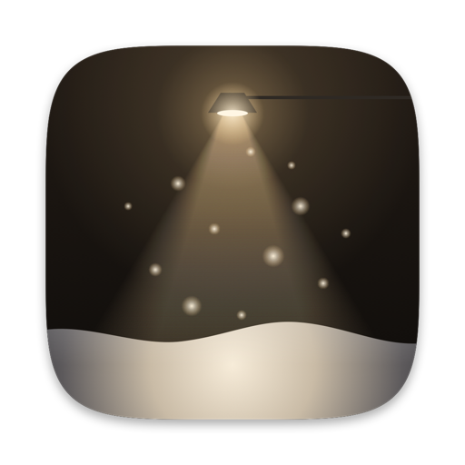

<p align="center">
  
</p>

<h1 align="center">VelvetFrost</h1>

<p align="center">A little weather and winter magic for your Windows desktop.</p>

VelvetFrost brings falling snow, rain, autumn leaves and cherry blossoms to your desktop. Snow gathers along the bottom of the screen and on window edges, moves around your cursor and falls when windows move. The app lives in the Windows notification area, where you can adjust or turn off the effects.

VelvetFrost is a Windows-focused fork of [Snowhush](https://github.com/mbezruchko/Snowhush), originally created by Mykhailo Bezruchko. It builds on Snowhush's desktop weather and adds a collection of interactive winter features. This fork supports **Windows 10 and Windows 11**; its releases are separate from upstream Snowhush releases.

## Explore your desktop

- Choose snow, rain, autumn leaves or cherry blossoms, or use Mixed mode to combine two kinds of weather. Halloween adds pumpkins and ghosts when snow is falling.
- Roll snow into balls and stack them into snowmen. Sculptures can be moved and are saved between runs.
- Catch falling cones to grow spruce, pine and fir trees. Decorate a tree with a boombox or lantern found in a present; a lit lantern also melts nearby snow.
- Store and place trees and opened rewards through Collection. Catch golden snowflakes for a chance to grow a legendary tree.
- Watch for a visiting arctic fox or bullfinch, or enable the snowplow, Christmas truck and Santa's sleigh in Settings.
- Adjust intensity, opacity, window interaction and individual monitors from the tray menu.

Trees, gifts and visitors appear as events, so they do not all arrive immediately. Some settings and interactions are available only when their conditions are met. When effects are hidden from screenshots, objects normally behind desktop icons are displayed in front of them instead; they remain behind ordinary windows.

## Installation and updates

VelvetFrost releases will be published separately from Snowhush at the fork's [GitHub repository](https://github.com/Solverg/VelvetFrost). See [RELEASING.md](RELEASING.md) for the local build and release checklist.

The Windows installer is per-user and currently unsigned, so Windows SmartScreen may display a warning. VelvetFrost has its own installation folder, settings and startup entry. Snowhush and VelvetFrost cannot run at the same time. Update checks use the fork's GitHub Releases by default; they need a publicly accessible release repository. The installer includes an offline license and notice viewer and installs the license and third-party notices beside the application.

## Building on Windows

Install Rust with the MSVC toolchain and the required Microsoft C++ build tools, then run from the repository root. Run Cargo from `windows/` so it loads the Windows build configuration:

```powershell
Push-Location windows
cargo build --locked --release --bin VelvetFrost
Pop-Location
```

The executable is `windows/target/release/VelvetFrost.exe`. For installer builds and release checks, see [RELEASING.md](RELEASING.md). The simulation is in `core/`, the Windows application in `windows/`, and the interface translations in `locales/`. More detail is available in the [Windows architecture](docs/windows-architecture.md) and [localization](docs/windows-localization.md) guides.

## Support

**Support VelvetFrost.** VelvetFrost is the Windows project developed by Vladimir Guliaev. Its interactive winter features include building snowmen, growing and decorating trees, finding gifts, keeping a collection, and watching festive vehicles and desktop visitors. To follow VelvetFrost and learn how to support its development, visit the [VelvetFrost Telegram channel](https://t.me/VelFrostApp).

**Support the original Snowhush.** VelvetFrost is built on Snowhush, created by Mykhailo Bezruchko, whose original project provides the foundation for the desktop weather and simulation. You can support the original author separately through [GitHub Sponsors](https://github.com/sponsors/mbezruchko). The repository's GitHub Sponsor button points to him.

## Credits and license

VelvetFrost is derived from [Snowhush](https://github.com/mbezruchko/Snowhush). The upstream required notice is preserved in [LICENSE](LICENSE):

> Required Notice: Copyright 2026 Mykhailo Bezruchko (https://github.com/mbezruchko/Snowhush)

The code in this repository is provided under the [PolyForm Noncommercial License 1.0.0](LICENSE). It permits use, distribution and changes for purposes allowed by that license and requires the license terms and required notices to accompany distributed copies. Commercial use is restricted; consult the license for its exact terms. The source is available for inspection, but this is not an open-source license as defined by the Open Source Initiative.

Third-party components have their own licenses; see [THIRD-PARTY-NOTICES.txt](THIRD-PARTY-NOTICES.txt) and the [Rust standard-library notices](notices/RUST-STANDARD-LIBRARY-NOTICES.html).
